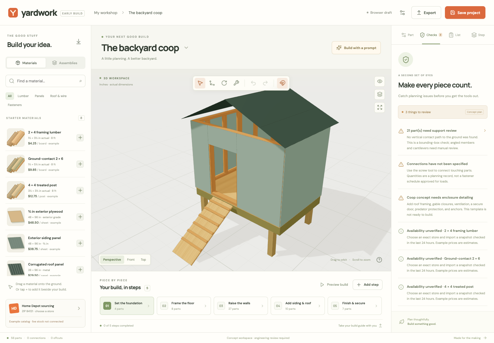

# Yardwork

**Plan it. Piece by piece.** An independent, self-hosted 3D workshop for planning DIY projects with editable materials, cuts, connections, shopping lists, and build guides.

Early working release. Not affiliated with The Home Depot.



## Run locally

Requires **Node 22.12+** and a WebGL-capable browser.

```sh
npm ci
npm run dev
```

Open [localhost:4173](http://localhost:4173). Project files are saved in `data/`; browser drafts are saved separately in local storage. Press **Save project** to persist to the server library. Export JSON for portable backups.

For a production build:

```sh
npm run build
NODE_ENV=production npm start
```

## Docker / Podman

```sh
docker compose up --build -d
# Or, with a working Podman machine and compose provider:
podman compose up --build -d
```

Visit [localhost:4173](http://localhost:4173). The named `projects` volume survives container replacement. `docker compose down` keeps it; **`docker compose down -v` deletes saved projects**. Back up the volume or export plans before deleting it. JSON persistence is designed for **one app process**, not multiple replicas sharing a directory.

Ports bind only to the local machine. This release has no user authentication; add authentication through a reverse proxy before deliberately exposing it beyond localhost.

## Try a build

1. Explore **The backyard coop**, a 6 × 4 ft elevated concept. Orbit the camera; switch to front/top views; use X-ray or exploded view to inspect the parts.
2. Drag a material onto the ground, or press its **+** button. Select a part to inspect actual dimensions. **M** enables the move gizmo; **R** enables rotation. Snapping uses a 1 in grid, 15° rotation increments, and nearby faces.
3. Cut lumber/plywood along its longest local axis. A ⅛ in kerf is removed and the remaining offcut stays in the project. Reuse an offcut from its inspector.
4. Select two touching parts with the screw tool, or use the inspector to specify a connection. The plan records quantity and length. This is not physical fastener simulation or capacity verification.
5. Use **Build with a prompt**: `wall 8 ft wide, 6 ft tall, 16 inches on center` or `base 6 by 4 ft`. Preview dimensions before applying. Generated parts stay individually editable. In **Sections**, select a generated wall or base and choose **Revise this section**. A targeted request such as `make it 10 ft wide` retains unspecified dimensions, placement, and its guide step. Preview part/connection changes and stock warnings before replacing it.
6. Add, edit, reorder, and complete build steps. Assign parts to a step. Recorded layout/cut/connection operations are included in the guide; undo restores the previous plan and activity record. Activity retains the most recent 5,000 entries.
7. Save, export JSON, take a CSV shopping list, or print the build guide / save it as PDF.

## Sections and whole assemblies

**Sections** groups parts into editable units. Use its numeric anchor/rotation fields or **Move section in 3D** to transform all members together. When snapping is enabled, section placement can align nearby bounding faces, such as a wall bottom on a base top. The whole-section selection tool lets you click a section in the scene; **V** returns to individual-part selection. Duplicating a section gives it independent part IDs, copies internal screw connections, and adds a build step. Removing a section is undoable.

Generated walls/bases retain their dimensions and spacing for later prompt-based revision. The coop contains separate floor, walls, enclosure, roof and ramp groups; its back and side wall frames can be regenerated. Manual sections move as a group but have no inferred dimensioned generator. Older version 1 projects can group their existing assembly labels in the Sections panel.

Regeneration **replaces the section's parts**, including manual geometry edits, and removes screw connections involving them. The preview shows those counts and incomplete stock estimates. Placement, the guide step, unrelated parts, project notes, and store settings remain. Automatically generated dimensional step titles update; custom instructions remain yours to review. Offcuts remain loose for reuse. Cloning an individual member keeps it in its section and makes the section a manually modified layout.

[See the section editor](docs/sections.png) · [See a targeted proposal](docs/section-proposal.png)

## Store snapshots — the first-version sourcing workflow

The default ZIP is **84121** and is configurable. No live product availability or current retail price is invented. The starter materials and their prices are examples.

In **List → Record store snapshot**, enter the exact Home Depot product URL/Internet number, matched stock unit/dimensions, unit price, available quantity, store ID, ZIP, and time checked. Saving selects that store and ZIP. The app compares reported quantities with stock units required. Snapshots are user observations, not independently verified data, and expire after 24 hours; future timestamps are ignored.

JSON inventory snapshots can also be imported. [Format example](public/examples/inventory.json) deliberately contains an old timestamp, zero availability, and a placeholder product number. Replace all example values with actual observations. The app never treats the example as current inventory.

Changing the store or ZIP invalidates mismatched inventory. Price fallbacks remain explicitly labeled examples. Lumber uses first-fit decreasing stock packing with saw kerf; panels conservatively use **one sheet per fitting part**, without sheet nesting. Hardware cloth uses a feasible 2D shelf layout on 24 × 300 in rolls, with rotation and zero-kerf snip cuts. It does not use area alone or claim globally minimum waste. The List panel and exported build guide include the actual cutting layout/coordinates. Oversized mesh is excluded from quantities and cost. Roof lap allowances, material grade, fastener compatibility, tax, delivery, and waste allowances are not calculated. Oversized parts are flagged and excluded from the cost, so a displayed total is not a complete quote when errors exist.

**Home Depot handoff:** choose **List → Prepare Home Depot list** or the same option in Export. Copy or download the prepared stock purchase list. In the retailer’s **My Account → Lists**, create a list, choose **Add Materials → Paste an Existing List**, review its draft and product matches, then move the resulting list into a Project. These steps are documented in [Home Depot’s list help](https://www.homedepot.com/c/create-a-list). The export retains fresh user-recorded product references, marks unverified products, and lists oversized parts separately as unresolved. Quantities refer to purchase units; cut pieces are not added a second time.

[See the prepared handoff](docs/home-depot-handoff.png) · [See a roll layout](docs/roll-layout.png)

The app does not sign in or create retailer lists, submit orders, synchronize accounts, or import its 3D JSON into Home Depot. The clipboard/download flow is browser-tested; accepting the resulting list inside an actual Home Depot account remains a separate verification step. Keep the Yardwork JSON for the editable model. Generic shopping CSV export remains available.

## AI

No account or API key is needed for the built-in **local command parser**. It supports explicit dimensioned walls, bases, and a fixed coop concept. It is labeled as a parser, not an AI model.

For natural-language interpretation with a local model, run Ollama separately and configure:

```sh
OLLAMA_URL=http://127.0.0.1:11434 OLLAMA_MODEL=llama3.2 npm run dev
```

The model must already be installed in your Ollama instance. In Docker Desktop, use a host reachable by the container, commonly `http://host.docker.internal:11434`; Podman commonly uses `host.containers.internal`. Configure the environment in compose. Do not use `127.0.0.1` to reach a host service from inside a container.

For a Docker-managed local model, use the optional overlay:

```sh
docker compose -f compose.yaml -f compose.ai.yaml up --build -d --wait
```

This starts the application, an Ollama CPU service, and a one-time model pull. The default model is [Qwen2.5 0.5B](https://ollama.com/library/qwen2.5:0.5b), approximately 398 MB of weights; the engine image is an additional download. The AI service has no published host port. The `ai-models` volume keeps model weights between restarts. Override the model with `YARDWORK_AI_MODEL` (for example `qwen2.5:1.5b`). Base `docker compose up` does not start or download a model. The optional engine and weights stay in containers and the named volume; a global host installation is not required.

Use the same `-f compose.yaml -f compose.ai.yaml` options for stop/restart/down. Adding `-v` deletes the model and project volumes. This uses the official [Ollama Docker service](https://docs.ollama.com/docker); structured commands require a local engine that supports [JSON-schema outputs](https://docs.ollama.com/capabilities/structured-outputs).

The selected section summary (name, dimensions, spacing, part count and section identifier) is sent with targeted requests. AI responses are constrained to the same `wall`, `foundation`, and fixed `coop` command schema; dimensions are validated and proposals require an explicit Apply action. AI cannot execute arbitrary code, purchase materials, or certify construction. No hosted AI service is called by default. The optional Ollama path has protocol-level mock coverage. The manually dispatched **Real AI qualification** workflow runs the actual engine/model, checks novel word-number wall/base prompts and targeted dimension retention, and saves/restores the generated geometry. Check that workflow’s latest result for real-model qualification; green mock tests alone do not prove inference works.

## Plan import and export

- **Yardwork JSON:** versioned, validated editable project files containing materials, transforms, offcuts, joints, ordered steps, history, inventory snapshots, and reference linework. Imports create a new project ID so they cannot overwrite saved originals.
- **ASCII DXF:** exploded `LINE` entities import as ground-plane references with explicit inches/feet/mm/meters selection. Use drawings near the origin. [Example 6 × 4 ft outline](public/examples/base-plan.dxf).
- **Shopping CSV:** quantities, sample/snapshot prices, availability evidence, product/search links, and excluded oversized-part counts. This is not a native Home Depot project file.
- **Build guide:** Markdown or browser print/PDF, including part dimensions, manual instructions, specified screw quantities, recorded operations, and roll cutting coordinates.
- **Home Depot handoff:** prepared text for the retailer’s documented paste-in material list workflow; manual review and retailer-side acceptance remain required.
- PDF/image-to-framing inference, DWG, IFC, arbitrary 3D model import, and automatic engineering interpretation are future work.

## What validation covers

Actual dimensions (including a nominal 2×4 being 1½ × 3½ in), stock fit, saw kerf, axis-aligned overlaps, a vertical contact path to the ground, disconnected screw records, basic screw penetration prompts, unusually high stud counts, and inventory shortfalls/freshness. Section advice compares extra framing pieces and 12 versus 16 inch stud quantities without prescribing a structural spacing.

Angled support uses conservative bounding boxes. Rotated collisions are not certified. No structural pass score is shown. Load paths, spans, snow/wind/seismic loads, foundation bearing/frost depth, corrosion, fastening capacity, local code, permits, and poultry welfare require appropriate external review. The coop is an intentionally incomplete **concept**, with roof framing, closures, ventilation, secure access, predator protection, and anchors still needing design. It is not a ready-to-build kit.

## Optional catalog provider

For a future authorized data source, configure `CATALOG_URL` and optionally `CATALOG_TOKEN` on the **server only**. The app calls your adapter with `?zip=84121&store=...`; return an array in the inventory JSON format. The token is passed in an Authorization Bearer header and never sent to the browser. No direct Home Depot API access is assumed. See [integration contract](docs/integrations.md).

`.env.example` lists supported variables. Export them through your shell, compose, or process manager; the server does not automatically load a `.env` file.

## Development and checks

```sh
npm run test          # engine, schema, storage, and integration protocol tests
npm run build         # strict TypeScript + production assets
npx playwright install chromium # CI/Linux; local macOS tests use installed Chrome
npm run test:e2e      # full browser flows, desktop and mobile
```

The browser test server uses port 4174 and a separate `test-results/server-data` directory. Tests do not alter normal `data/`. GitHub Actions also builds the container and verifies persistence after restart.

React 19 · React Three Fiber / Three.js · TypeScript · Express · Zod · Vite. Persistence uses atomic JSON file replacement plus revision checks to prevent two tabs overwriting each other's saved work.

## Next directions

[Product research and scope](docs/research.md) · [Architecture and roadmap](docs/architecture.md) · [Integration contract](docs/integrations.md) · [Requirement audit](docs/requirements-audit.md)

Bathroom, pool, drain, excavation, and site constraints are planned extensions rather than supported construction systems in this release.

MIT licensed.
