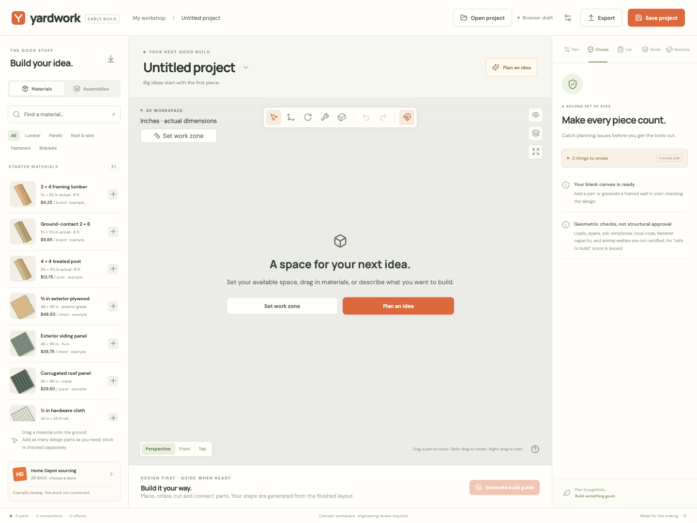

# Yardwork

Use **Sections → Review lid travel** to play or scrub a storage-seat lid. Playback stops at a detected obstruction, work-zone boundary, or measured clearance limit. See [lid motion and clearance](docs/lid-motion.md) for the workflow and its geometry boundaries.

For a storage lid, **Lid travel → Fit a folding lid stay** lets you enter the measured pin positions and arm lengths. Preview the linkage, test for a reach limit up to 90°, and add a separately selected handed Everbilt model to the Home Depot list. The fit and pin marks appear in the build guide.

Under **Checks → Project code references**, a through-wall plumbing vent can use measured wall, terminal, lot-line and grade points. These positions appear in 3D and the project guide. Enter the build jurisdiction, code path and date for the Utah review.

For a closet with sourced Everbilt rods, open **Sections → Fit closet rods → End socket backplates** after saving the rod fit. Measure each delivered backplate from the rod center. Yardwork shows where the measured envelope crosses a retained panel edge or cutout, and exports the marks with the build guide.

**Plan it. Piece by piece.** An independent, self-hosted 3D workshop for planning DIY projects with editable materials, cuts, connections, shopping lists, and build guides.

**Lift (L)** or **Alt-drag** moves selected wood vertically; Raise/Lower offers exact increments. Copy/paste and duplicate work for parts and whole sections. Material families now share a card with length/source options, and **Cut pool** collects used cuts and reusable offcuts. Solid wood separates onto clear faces instead of retaining intersections. [Movement, copying and cut-pool guide](docs/move-copy-and-cut-pool.md).

**Checks → Fit stock between faces** previews a real board between selected retained faces, with independent end-clearance units, cross-section roll and an explicit datum. Review its cut and genuine remnant, then Add through ordinary Undo or Cancel without changing the project. The new part opens two end-connection actions and shares one physical stock source with its remnant. [Fitted-stock workflow](docs/fitted-stock.md).

Early working release. Not affiliated with The Home Depot or Lowe’s. See [product readiness and remaining work](docs/product-readiness.md) for the distinction between editable studies and complete builds.

[Sealing wood joints and openings](docs/sealing-and-air-barrier.md) records construction references for air seals, drainage, panel spacing, and adhesive details.

**Checks → Review connection decisions → Banquette construction** separates current closed-seat contacts from exact frame/shell connection pairs. Start a screw/connector plan for the actual members or resume its existing W/C record, then include the findings in Markdown and print. Small screens can **Expand inspector** without replacing the editor or resetting the workspace. [Banquette review workflow](docs/banquette-construction.md).

The canvas starts with the assembly; **Show offcut stock** or select an O-labeled remnant to inspect retained stock, then **Back to assembly**. Successful fitted-stock previews bring Add/Cancel/Inspect into view. **Part → Build stage** keeps a custom part in its chosen task through guide regeneration; the guide also preserves deliberate Earlier/Later ordering. [Build stages and stock inspection](docs/guide-placement.md).

**Guide → Review build preparation** lists assembly stages or hardware reviews scheduled ahead of their modeled prerequisites. For example, it checks that a banquette hinge review sits between the shell and lid tasks and that shelf-pin drilling review comes before shelf placement. Select a finding to open that step, then use **Earlier** or **Later** to adjust the order. The findings also appear in the Markdown and print guides.

**Assemblies → Floor & foundation** opens a floor base with independent width and depth units, joist spacing, and separate rim and joist stock choices. **Framing size** sets the same actual depth for both member types. The reviewed Home Depot options include 2 × 6 boards and treated 2 × 8 boards in 8 ft and 10 ft lengths. Preview the cuts and estimated purchases before adding the editable parts. **Revise this section** reopens the saved settings. [8 ft treated 2 × 8](https://www.homedepot.com/p/206937455) · [10 ft treated 2 × 8](https://www.homedepot.com/p/206937440)

Open **Compare board lengths** to compare the current selection with the least total lumber or fewest whole boards for the same base. The comparison uses the project's cut packing and modeled saw kerf. It covers one stock length for rims and one for joists.

Open **Sections → Review floor-base joist ends** to see the contact at each rim, including gaps after a cut and flush ends that need a connector-backing check. Inspect either end or open the wood-fastener planner for the selected pair. The printable and downloadable guides list the same joints and saved fastening records. [Simpson Strong-Tie hanger installation reference](https://www.strongtie.com/resources/product-installers-guide/lus-installation)

Inside that review, **Plan face-mount hangers** checks the measured flange reach against the modeled rim ends and joist spacing. Select the ends you want to keep in the plan. The guide and Home Depot handoff count the matching ends and keep SD9112 rim screws and SD9212 joist screws in separate packs. A changed joist drops out of the estimate until reviewed. Confirm the actual installation detail, including header thickness, treatment and exposure. [LUS26Z](https://www.homedepot.com/p/100375105) · [LUS28Z](https://www.homedepot.com/p/100374921) · [ESR-3096 Table 20](https://icc-es.org/wp-content/uploads/report-directory/ESR-3096.pdf)

For Home Depot projects, **Part → View stock cut plan → Change stock for this part** previews matching board lengths and supported same-thickness casework sheets before a source is recorded. The part keeps its finished dimensions, placement and cuts. Review the revised purchase quantities and connections before recording the new cut order. Rebuilding a generated section uses its saved stock choices.

In **List → Compare stock for … parts**, compare one exact Home Depot alternate for the parts on a material line with no recorded source. See the purchase quantities and total board length. Use **Record snapshot for alternate** to enter the price and quantity you checked for that exact listing before changing any parts. The comparison shows an observed subtotal when every affected purchase has a fresh price. Store prices and quantities expire in the open comparison and handoff after 24 hours. Recorded stock and offcuts stay tied to their original sources. One Undo reverses the stock change.

In **List → Stock cut order**, use **Record multiple stock units** after checking the cut orders for that material. Yardwork links the parts to their original stock units and puts the modeled remnants in the **Cut pool**. Mark the group on hand if you already own all of those units. One Undo reverses the group recording.

**List → Recorded cut source** shows actual kept/offcut blank regions, dimensions and starts on the original board or sheet. Inspect its P/O parts and export the same layout in Markdown/print. Unretained regions stay separate from a proven saw kerf or cut sequence. [Recorded source layouts](docs/recorded-cut-sources.md).

In **List**, open **Blade kerf for this material** under a wood stock line. Preview the purchase count, cut order and leftover sizes with your blade width, then apply the layout. The setting applies to unrecorded stock of that material in this project. When you record those cuts, the value stays with the physical board or sheet and its offcuts.

Before the first cut on a wood board, sheet or measured offcut, open **Cut part → Blade kerf** and enter the width your blade removes in inches. The preview, resulting offcuts and source layout use this width. It stays with the source when you reuse a remnant. The recorded cut order includes it for straight cuts. Blade specifications give the nominal kerf for the actual blade, such as 0.059 in for Diablo’s framing blade or 0.126 in for Freud’s P410. [Diablo D0724A specs](https://diablotools.com/products/D0724A) · [Freud P410 specs](https://www.freudtools.com/products/P410)

**Guide → Review build preparation → Pressure-treated wood cuts** lists the labeled parts and offcuts with planned trims, recorded cut faces, holes or profiles. Inspect a row before covering the surface, or ask **“Which cuts need field treatment?”** in **Plan an idea**. The printed and Markdown guides carry the same review. Use the delivered lumber’s treatment tag and the preservative label to confirm what applies. [American Wood Council field treatment guidance](https://awc.org/faq/what-is-the-best-way-to-deal-with-the-exposed-ends-of-unpreserved-wood-when-pressure-treated-wood-is-cut/)

**Cut part → Round opening** previews a through-hole or rounded edge notch in rectangular stock. Click the preview to place its center, or enter exact edge marks and diameter. The cut appears in the 3D clearance checks and the build guide. Review the cutter and accessory for the actual material and opening. Sauna ventilation openings stay linked to their layout.

**Cut part → Rectangular cut** models a rectangular opening or an edge notch. Set the two starting marks and cut dimensions on the labeled face. Motion and contact checks follow the retained shape, and the guide gives the marks on the actual blank.

After following a board or sheet’s **Stock cut order**, choose **Record this stock unit**. Yardwork links the existing parts to one source, keeps the cut order in the guide, and puts rectangular leftovers in the **Cut pool**. Reusing one of those leftovers keeps the original material source and purchase count.

Import the [crosscut practice plan](public/examples/cut-pool/crosscut-practice.yardwork.json), then choose **Cut pool → Review offcut reuse**. The 18 in jig blank and 12 in finish test blank come from the remnant of the first 36 in cut. The stock estimate drops from two boards to one and leaves a 29⅝ in remnant. [Completed cut guide](public/examples/cut-pool/crosscut-practice-guide.md)

When trimming both dimensions of a rectangular wood part, compare **Crosscut first** and **Rip first**. Choose **Find uses for these offcuts** to preview fitted parts and the change in stock to buy. **Apply cuts and reuse** saves the trim and assignments together. The build guide lists the original trim before the parts cut from its remnants. The preview follows the modeled grain direction. Confirm the actual sheet markings where panel orientation matters. [APA plywood reference](https://www.apawood.org/engineered-wood-products/plywood-osb/plywood/)

For board crosscuts, Yardwork can move or swap pieces between planned boards to leave room for the blade while keeping the board count. A unit with an unresolved edge trim stays marked for review.



[See an idea proposal](docs/banquette-proposal.png) · [See the editable banquette](docs/banquette-workspace.png)

## Use Yardwork online

[Open the browser workshop](https://hochipants.github.io/yardwork/) to edit plans, use local planning presets, test movement, and export cut lists and guides. **Save project** keeps a library on the current device with up to three earlier saves. Export editable projects to move them between devices, or download a workshop backup to restore with the self-hosted app.

## Run locally

Requires **Node 22.13+** and a WebGL-capable browser.

```sh
npm ci
npm run dev
```

Open [localhost:4173](http://localhost:4173). Project files are saved in `data/`; browser drafts are saved separately in local storage. Press **Save project** to persist to the server library. Export JSON for portable backups.

**Open project → Earlier saves** keeps up to three previous saved revisions for each project. You can open one as a fresh copy, including when the latest file is damaged or missing. The original files and earlier saves use the same data volume.

Choose **Open project → Download workshop backup** to take every saved project and its earlier revisions off the server in one file. Save any browser drafts you want to include. Restore into a new directory, then point a Yardwork server at it.

```sh
npm run restore-workshop -- ./yardwork-backup.gz ./restored-workshop
NODE_ENV=production DATA_DIR="$PWD/restored-workshop" PORT=4178 npm run start
```

For a container, mount the restored folder at `/app/data`. Restore checks the complete archive before publishing the new directory.

For a production build:

```sh
npm run build
NODE_ENV=production npm start
```

## Docker / Podman

```sh
docker compose up --build -d
# Or, with a working Podman machine and compose provider:
podman compose up --build -d
```

Visit [localhost:4173](http://localhost:4173). The named `projects` volume survives container replacement. `docker compose down` keeps it; **`docker compose down -v` deletes saved projects**. Back up the volume or export plans before deleting it. JSON persistence is designed for **one app process**, not multiple replicas sharing a directory.

Ports bind only to the local machine. This release has no user authentication; add authentication through a reverse proxy before deliberately exposing it beyond localhost.

## Design first

Every launch starts with an **empty project**. Choose **Open project** to load saved work or explicitly resume a browser draft. Starting the app does not overwrite the previous draft; the preceding draft is also retained locally when a new design begins. Old coop plans remain loadable, but the coop is no longer offered as a starting point or generator.

1. Choose **Set work zone**. Each dimension has an independent inches/feet selector; switching units preserves its physical value. Its outline is centered on the X/Z grid and starts at floor Y=0. This is a planning envelope, not room surveying. Checks flag parts outside it; stock can temporarily sit outside while being cut.
2. Drag a stock item into the workspace, or use **+** repeatedly. Catalog pictures represent one product, not an inventory quantity. The 34 choices include 21 generic planning stocks and 13 exact reviewed variants: two retailer-specific 1×4 boards, a Lowe’s SYP 2×4 and treated 4×4 post, .703 in Plytanium plywood, SUNLITE 8 mm panel, a Project Source closet rod, Simpson screws and connector nails, exact Lowe’s 1×6 whitewood and 2×6 SYP boards, and manual .188/.453 in PureBond interior sheets. Exact variants are unpriced until observed; generic prices are examples. Manual-only stock is not automatically assigned to generated framing, seats or carcasses. See [catalog coverage](docs/catalog-coverage.md).
3. **Drag a part to move it horizontally. Shift-drag to rotate around vertical Y. Right-drag orbits the camera; middle-drag pans.** Move (M) and Rotate (R) retain precision gizmos. Selected-part actions include **Turn 90°**, **Tip 90°**, and **Cut part** (C). Quarter turns preserve floor contact for grounded parts. Snapping aligns nearby faces and avoids introducing solid collisions; arbitrary angled joinery is not inferred.
4. **Cut part** opens the retained-length/width editor. For wood, choose **Angled cut**, select the width or thickness face, then enter both edge marks from the same starting end. Preview which side to keep and apply the cut. Both shapes share the original board or sheet with a modeled ⅛ in kerf, and the extra shape appears in **Cut pool**. **List → Recorded cut source** shows the faces of an angled split. The guide carries the finished face marks and tool review. Tube cuts keep the product’s outside diameter fixed. Plastic and metal use separate tool requirements.
5. Choose touching parts and exact catalog connection hardware. In **Checks → Review connection decisions**, choose a wood pair and open its screw plan. **Preview centered entry** shows a direction through the actual contact patch. **Use centered entry** saves one editable location for depth, spacing and tool-access review. You can also start an empty plan. Screw/nail lengths have distinct purchase packs; brackets are counted individually. Unspecified legacy sizes are flagged and excluded, never substituted silently. Placed hardware and connection records can represent the same item; duplication is flagged for review.
   The **Shelf bearing** and **Seat bearing** checks mark the actual contact patches under shelf studies and closed seats. Look for a green patch at each expected cleat or rail. The check flags a panel whose center lies outside its wood contacts, and lists saved shelf-pin geometry reviews when there is a pin plan. The build guide carries the result alongside the remaining load and attachment decisions.
6. **Plan an idea** accepts storage banquettes, straight/L-shaped benches, workbenches, cabinets, framed shelves, plywood bookcases, frames, greenhouses, sauna framing and closet inserts through disclosed local presets. Follow-ups preserve unspecified settings. Preview the dimensions, assumptions, suggestions, stock fit and work-zone fit before adding editable parts. Unsupported ideas return useful questions. Connected Ollama supports a broader module-based proposal grammar.

   In **Plan an idea → Questions about this build**, try “What looks weak in this build?”, “Can the cabinet door open?” or “What can I use O001 for?” Yardwork reads the open project locally. The answers link to the current checks, named motion tests or offcut cut order. Use the exact motion name or part label if several parts match. Review physical loads, hardware and site conditions for the finished build. [APA plywood design guidance](https://www.apawood.org/engineered-wood-products/plywood-osb/plywood/) · [Blum hinge planning reference](https://publications.blum.com/2026/catalogue/en/78/)
7. When the layout is ready, choose **Generate build guide**. Stages follow the saved assembly: carcass and shelves, storage bottom/frame and shell/lid, or greenhouse/sauna framing and actual coverings. No manual step setup is required. Every active part is assigned once. Stage identities, custom titles/notes, explicit part-stage choices, deliberate order of surviving steps and history survive regeneration; changed assemblies reset their review marks while unchanged assemblies retain them. Recorded cuts/connections and anchored manual steps remain. Design, assignment, sourcing or tool changes mark the guide stale. Review inferred assembly order and connection details. Guide exports can generate the sequence automatically. Missing fastening schedules stay explicit; connection records list actual endpoints, hardware and nominal lengths without inventing holes or engagement.

## Sections and whole assemblies

Sections group editable parts into units. Use numeric anchors/rotations or **Move section in 3D** to transform all members. Face snapping can align a wall bottom with a base top. Duplicating a section gives it independent part IDs and copies internal connection records. Removal and idea application are undoable.

Generated wall/base sections retain dimensions for **Revise this section**. Targeted regeneration replaces only their parts and removes connections involving them; placement, unrelated parts, settings, and custom notes remain. Furniture recipes expose dimensions and stock choices in the section editor. Regeneration replaces affected parts/connections with a disclosed preview. Storage lid access preserves actual cuts and manual edits around its provisional rear pivot; hardware and pinch protection still need design. Offcuts remain loose for reuse and are hidden from the default assembly view; selecting a remnant or Show offcut stock reveals it without changing cuts, purchases or exports.

Applied ideas now retain their saved design identity. In **Sections → Saved designs**, revise the whole design or an individual assembly after saving/reopening. Unchanged assemblies keep their actual parts, cuts, stock provenance and connections. The preview counts replacements and affected connections; destructive revisions require an explicit review, while original custom cut stock remains available as loose reusable parts. Stale proposals cannot overwrite a changed design. **Position and rotation** moves a furniture module or an entire structure family without rebuilding parts; coordinates have independent length units and rotation uses degrees.

In **Checks → Measured site clearances**, record a wall or baseboard face, its signed grid coordinate, and the minimum gap. Enter the measured height for a low face. Select **Entire project** to apply a measurement to hand-built and generated parts, or choose a saved design to limit its scope. **Show face** draws the measurement and minimum gap in 3D. For a face assigned to one design, **Move** can shift that design to meet the gap after checking the work zone, nearby wood, and other measured faces. **Test movement** and **Review lid travel** include the corresponding face checks, and the build guide lists the measurements and results.


**Panel bookcases** retain one saved family rather than eight unrelated panel recipes. Overall width, depth, height and shelf count revise the entire carcass while preserving the selected stock thickness. Clear vertical openings stay equal; shelf front setback is separate. Try “add a shelf” or “remove one shelf and make this bookcase 84 inches tall,” then review the proposal. Each panel remains directly editable, and replacing a manually cut panel requires review. Ordinary lumber-framed shelving remains a separate recipe.

Older furniture sections can enable revisions using their saved recipe as a baseline while keeping custom cuts. **Make independent parts** removes design controls and retains geometry/connections; Undo restores the binding. Older structures without a typed family record remain manually editable rather than being guessed from their names. On phones, **Open project → Import a plan** provides the import path.

**Assemblies → Explore whole builds** offers the five acceptance studies. Adjust dimensions and choose source-qualified materials before opening a separate draft. The draft being left remains under Open project. These are editable design studies with missing components/installation decisions listed, not construction-ready kits. Sauna heat-compatible layers/heater/bench systems, greenhouse ventilation/attachments and load-dependent joinery remain unresolved.

**Sections → Plan shelf supports** saves explicit bearing targets on selected bookcase or closet-tower shelves. Existing closet panels need explicit role confirmation; exact geometric suggestions do not modify parts until accepted. Choose side-edge offsets and custom or 32 mm rows, then record actual pin/bore measurements with a basis/date. Missing values stay blank. The scene distinguishes bearing targets from candidate hole centers; cut, moved or regenerated members require reviewed refresh. These diagrams do not install pin meshes, drill physical holes or qualify loads. List/Checks show planned-pin purchase shortfalls; **Add missing pin packs** compares existing selected packs once and credits no tool-kit contents. Guides include drilling-review phases and a separate support-coordinate CSV. Carcass joinery and wall/anti-tip attachment remain unresolved.

New project exports use **format 96**. Valid formats 1–95 migrate in memory and explicit saves write format 96. Existing project originals stay on disk until saved. Versioned browser-draft keys and recovery copies support reopening old drafts. See [format and recovery](docs/project-format.md).

**Sections → Plan furniture anti-tip restraints** records a separate receiver-to-wall review for exact kit 9976524. Each plan starts without a receiver or locations. Choose each intended location, actual connected solid-wood receiver, recorded joints and wood-stud evidence; fitting/screw/pilot dimensions stay unresolved until reviewed. Source-stock limits, impossible screw/nail reach, retained mounting depth and measured cable reach are checked. User evidence remains separate from manufacturer facts; the state never becomes installation or capacity approval. Missing whole kits can be added explicitly, with all eleven included components counted within the kit.

Printed guides, sheet diagrams, legends, cut previews and Markdown use the same persistent P/O part labels and precise decimal inches. Hole schedules reference named edges of the rectangular panel blank; establish/transfer datums before profile cuts. Undo keeps printed label reservations. Full IDs and numerical coordinates remain in JSON/CSV; stale/conflicting schedules withhold drill dimensions.

In a generated **Guide**, open **Find or print part labels** to print cut-out tags for the current step or the entire build. Search for a tag such as P012 and select its match to isolate the exact part in 3D. **Show step context** adds the preceding parts while keeping the labeled piece highlighted.

The **Tools** tab derives requirements from parts, cuts, joints and explicit attachment plans. It lists models relevant to the current project first. For each angled lumber crosscut, the checklist gives the part label and geometric face angle. The Bosch GCM12SD reference covers the documented miter-saw function. Use its manual to review the actual stock, angle combination, blade and setup. Plastic, metal, partial profiles and other operations have their own requirements. Guides include the checklist and manufacturing evidence. Tool selections record reviewed models and leave purchase quantities and geometry untouched.

In **Tools**, open an operation to see matching Home Depot options and add a package to the list. **List → Tools to buy** holds the chosen packages, quantities, and store observations. The Home Depot paste list and shopping CSV include those purchases, and the guide has a separate tool section. The materials subtotal excludes tool purchases. Eye and hearing protection have separate model reviews. Use the delivered product markings, fit, and operation instructions when checking protection.

For SUNLITE 8 mm glazing, **List → SUNLITE panel accessory estimate** measures the retained edges of the actual panels. It lists upper and lower tape separately, groups unambiguous full-length seams, and lays out nominal cuts across the 8-foot profile stock. Review partial joins, trim and expansion allowances against the installed panel system. **Add missing estimated supplies** fills deficits in the existing shopping list where the chosen retailer has exact reviewed listings. The estimate and part labels appear in the build guide.

**List → Measured glazing profile cuts** highlights the chosen edge in 3D. Enter its finished length and field notes, plus each profile's usable stock length and saw kerf. The measured cut list groups cuts onto exact stock units, tracks expected remainders, and adds missing units for measured runs to the shopping list. If a panel moves, measure its affected edges again. Unmeasured edges and unresolved transitions remain in the accessory estimate. Verify the delivered profile fit and finish cuts before use.

**List → Glazing tape cut plan** lets you measure one strip at a time or fill unmeasured edges from the checked layout with separate upper and lower trim allowances. The guide lists strips and the length left on each roll. Yardwork counts one 32 ft upper roll and one 32 ft lower roll per kit. A changed edge needs review before the cut plan can add kits to the list. [Home Depot SUNLITE 92763](https://www.homedepot.com/p/205713443) · [Palram installation guide](https://images.thdstatic.com/catalog/pdfImages/a0/a03f682e-0dd7-4594-a1e2-2cd0c9e01918.pdf)

For the sauna study, **Source-matched stock options → Wall cavity insulation** can fill the modeled stud bays with editable Johns Manville U1330 batts. The door opening stays clear. The parts, batt layouts and fitting stage appear in the build guide. Pricing uses 11-batt bags from the selected retailer and store snapshot.

Choose **Ceiling joist stock** and **Ceiling cavity insulation** separately. The sourced 2 × 12 choices give an 11¼ in cavity for the 9½ in Owens Corning C84A batts. The framing grows above the ceiling so the finished room keeps its clear height. **Show ceiling insulation** isolates the joists and batt cuts in 3D. The guide lists the cuts and the shopping list counts 10-batt bags. Shallow cavities report a fit issue before any batt is added. Verify actual framing, support, and the full heated-room assembly before building. [Ceiling materials and sources](docs/sauna-material-options.md#ceiling-layout-in-yardwork)

After moving or trimming a batt, open **Checks → Sauna ceiling insulation gap** to see the uncovered full-depth footprint in 3D. The review uses the saved positions and retained cuts. A remnant covers a gap after you place it in the assembly. The generated and printable guide includes the current coverage review.

In the sauna study, choose **Source-matched stock options → Wall and ceiling lining** for Cedarbrook's raw cedar. Yardwork models each course at 3 in of installed coverage, preserves the entered clear interior and rough opening, and calculates cuts and six-board bundles. Use the Cedarbrook link in **List** for availability and pricing. Resolve the rest of the interior layer, corner and expansion details, seam backing, attachment and penetrations before building. [Cedarbrook board and bundle specification](https://cedarbrooksauna.com/6ft-1x4-tg-cedar-paneling-bundle/)

In **Checks → Sauna lining backing**, review where the saved walls or ceiling have a gap behind the cedar, or a board end falls outside the nearby framing. Select either warning to inspect a labeled board. The same review and fastener references appear in the cedar guide step and guide export. The references give you a Home Depot part number for matching finish nails and nailer. Confirm nail penetration, course ends and the actual wall and ceiling layers before buying or fastening. [Cedarbrook finish nail guidance](https://cedarbrooksauna.com/what-nails-should-i-use-for-tongue-and-groove-panel-boards/)

In **List → Sauna lining nails and nailer**, enter the nail count from your reviewed fastening layout, after subtracting nails on hand. Yardwork rounds up to 2,000-nail Paslode 650282 boxes and accounts for boxes already on the list. Add the 515500 nailer separately if needed, and review the required air supply under **Tools**. The shopping CSV keeps tools and fasteners separate, and both prices use the project’s store snapshot. [Paslode nail specification](https://www.paslode.com/fasteners/16-gauge-straight-galvanized-finish-nails), [Paslode nailer specification](https://www.paslode.com/tools/pneumatic-16-ga-straight-finish-nailer)

Choose **Source-matched stock options → Wall and ceiling foil** to plan the sauna vapor layer. The guide sequences the ceiling and walls and shows flat cuts with 4 in laps and 3 in ceiling turn-downs. The **Foil roll cut layout** uses the supplied 54 in width and reports the continuous length to request. Confirm the supplier's delivered lengths and check field backing, opening and floor terminations, and penetrations. [Cedarbrook foil specification](https://cedarbrooksauna.com/sauna-foil-vapor-barrier/), [Cedarbrook installation](https://cedarbrooksauna.com/how-do-you-apply-sauna-foil-vapor-barrier/)

Choose **Source-matched stock options → Sauna door** to set the 24 × 76 in rough opening and place Cedarbrook's 22 × 74½ × 2⅝ in closed leaf. The shopping list counts one prehung kit. In **Test movement → Set up sauna door**, choose the hinge side as viewed from outside and enter offsets for the actual pivot. Play the outward swing or use the slider to inspect obstacles. Record the measured finished wall depth for Cedarbrook's jamb rounding. Verify trim, handle, hinge action and release from inside with the delivered kit. [Cedarbrook prehung door specification](https://cedarbrooksauna.com/cedar-clad-sauna-door-24x76-ro-no-window/)

Choose **Source-matched stock options → Freestanding sauna bench** to place a 4 ft or 5 ft Cedarbrook pedestal kit. Use the seating view to check layout, then move or rotate the bench in the workshop. Checks use the kit’s outer dimensions for room fit, the immediate doorway approach and the selected heater’s modeled clearance. Each placed kit contributes one supplier purchase and an assembly stage. Verify the delivered supports, hardware and stability on the finished floor. [4 ft bench specification](https://cedarbrooksauna.com/4-foot-cedar-bench-18x48-freestanding-pedestal/), [5 ft bench specification](https://cedarbrooksauna.com/5-foot-cedar-bench-18x60-freestanding-pedestal/), [Cedarbrook assembly instructions](https://cedarbrooksauna.com/wp-content/uploads/2024/08/pedestal-bench-instructions.pdf)


Use **Test movement** in the workspace toolbar or **Sections → Test door or drawer movement** to group the parts of a door, lid, drawer or sliding panel. Choose a swing axis and pivot or the slide direction and maximum extension. The blue line shows your hinge axis or slide path. Play opening or closing to stop at the first detected obstruction or work-zone limit in that direction. Use the slider or the **Inspect fully open** and **Inspect fully closed** controls to examine an individual pose. Choose **Hold other parts open** to set several nearby mechanisms to independent positions and watch the clearance results update. All preview positions are temporary. The guide records checks against the saved project geometry. Use real hardware dimensions and travel limits when setting up the plan. Verify loads, mounting and hardware behavior separately.

Choose **Focus these parts** in a door, drawer or lid collision result to frame the two pieces involved. **Show full project** restores the surrounding model at the same preview position.

In **Test movement → Check a minimum gap**, choose the moving part, a nearby modeled part and your required spacing. The check covers the whole tested path, including linked motions and saved opening orders. A shortfall shows an observed gap and opens that pose in 3D. Save the test setup or name the test to include it in the build guide. Choose hardware spacing from its own instructions and model accessories you want to check. [Accuride 3732 installation reference](https://www.accuride.com/media/amasty/amfile/attach/a3bcba75b0b82de060a661de95ce9f44.pdf)

Choose **Edit obstruction** from that view to open the obstructing piece in the Part inspector. After moving or resizing it, choose **Retest clearance**. The motion starts closed with the same held parts and opening order, using your current layout.


In **Explore whole builds → Greenhouse**, check **Add a roof vent**. Choose a rafter bay and two measurements along the roof slope. The study adds blocking and a sash between full-length rafters, plus the separate glazing cuts when SUNLITE is selected. Use **Test movement → Set up greenhouse roof vent** to check the opening travel. Review flashing, hinge support, hold-open hardware and ventilation performance for the built assembly.

With SUNLITE selected, the greenhouse study checks the full shared roof seams for gaps in modeled backing. Open **Checks → Roof glazing seams need backing review** to highlight the unsupported portions, then use the guide to review the measured lengths. Partial seams and vent transitions appear in the separate accessory review. Verify backing width, connector fit and the fastening plan against the delivered system. [Palram roof connector detail](https://images.thdstatic.com/catalog/pdfImages/21/21944515-ca0f-4db2-b0c5-2864c2070043.pdf)

Under **Checks**, open **Greenhouse rafters → Eave bearing** or **Ridge fit**, then choose **Show joints in 3D**. Green patches mark wood face contact and orange marks identify ends that need review. The eave check follows contact to the wall plates, including through a wood block that sits on a plate. The guide lists the result and any measured gap for each rafter. Verify seat or hanger details, the ridge supports, tie-downs and loads before construction.

Use **Checks → Fit an eave block** to preview a wood fitting for one rafter end at a time. Choose the rafter and stock. The preview shows the crosscut length, the minimum and maximum bevel heights, and any reusable end offcut. **Add eave block** puts the editable profile in the roof framing and updates the bearing check. Leave **Use a matching offcut first** on to share the same board across blocks. The connection design remains a separate guide task.

Open **Checks → Review greenhouse roof attachments** to review the exact part pairs at the eaves and ridge. A fitted block has a row for the rafter side and a row for the plate side. **Plan screw path** opens the editor with that pair selected. Saved plans and changed fits appear in the guide with the remaining attachment work.

For a saved greenhouse, choose **Test movement → Set up greenhouse door**. Yardwork includes the frame and any door glazing. Pick the hinge side from outside and enter offsets from the closed leaf to match the installed axis. The setup offers separate exact hinge-and-latch kits for Home Depot and Lowe’s, with one kit per door when added to the shopping list. Confirm mounting space, backing, fasteners and the inside release on the actual assembly.

In **Test movement → Fit a drawer box**, select two fixed cabinet sides. Yardwork measures the opening, compares slide lengths and uses the selected plywood thickness to size the five box panels. Preview a closed drawer and its first opening obstruction before adding the editable box and movement test. You can add an inset finished front and use matching plywood from the Cut pool. **Plan an idea** also accepts **“Plan a drawer between P001 and P002”** using the cabinet's part labels. [Accuride installation guide](https://www.accuride.com/media/amasty/amfile/attach/a3bcba75b0b82de060a661de95ce9f44.pdf) · [Kreg drawer box reference](https://learn.kregtool.com/plans/kreg-workbench-with-drawer/)

On an Accuride 3732 drawer under **Test movement**, open **Drawer rail mounting** to enter the delivered rail measurements and screw locations. Yardwork shows all four rail faces in 3D and checks that the footprints and entered screw paths fit retained wood. Checked marks appear in the build guide. Layouts with conflicts or changed mounting panels need review before the guide supplies drilling coordinates. For each pair of rails, reserve included or on-hand screws or choose the field-checked [Everbilt 801582 pack](https://www.homedepot.com/p/204275069). Checked positions count toward the Home Depot shopping list by pack. [Accuride mounting instructions](https://www.accuride.com/media/amasty/amfile/attach/a3bcba75b0b82de060a661de95ce9f44.pdf)

For a frameless drawer, open **Test movement → Compare slide fit** in a sliding motion and select the two drawer sides and two cabinet panels. Yardwork compares six Accuride 3732 pairs from 14 to 24 in using the available mounting span, both side gaps, drawer width and rail height. Choose a fitting size to use its documented travel in the opening test. The build guide records the exact model, and the shopping list counts one left/right pair per drawer. If different models are saved for the same drawer, choose one before adding its hardware. Confirm the delivered hardware and installation instructions before drilling.

In **Test movement**, choose a **Second motion** and set the **Opening order** to test both. To check a drawer behind a door, select the door first. Yardwork tests the door swing with the drawer closed, then the drawer travel with the door open. Closing reverses the order. You can also move both together or hold additional parts at fixed positions. Play the test to stop before a modeled collision, use the slider to inspect a pose, and save the setup to include its results in the guide. The preview leaves the saved part positions intact.

For a hinge that shifts as it opens, edit its swing under **Test movement → Measured hinge path**. Set the closed hinge axis through a reference mark on the door. At each measured angle, enter the mark’s signed X, Y and Z movement from closed. Yardwork uses the readings for opening, closing, room and clearance checks, and tests with drawers. Match the final reading to the maximum opening. The preview interpolates between readings, so measure where the door passes trim or another part. Use the delivered hinge and mounting arrangement to determine the actual path and opening stop. [Blum planning reference on front protrusion and opening stops](https://publications.blum.com/2026/catalogue/en/79/)

For a cabinet beside a wall or trim, open **Set travel targets for this test** after choosing an opening order. Enter the door angle and the drawer extension you need. The first part holds its target while the second moves. Save a named test to record both targets and the result in your guide. Verify the actual door path, protrusion and stops on concealed or multi-link hinges. [Blum catalog on inner drawers, hinge protrusion, and opening stops](https://publications.blum.com/2026/catalogue/en/78/)

After fitting greenhouse door stops, open **Test movement → Plan door weatherseal** or ask **“How should I weatherstrip the greenhouse door?”** in Plan an idea. Yardwork checks all three wood runs for the listed gap, mounting width and minimum-gap swing. Save the reviewed cut plan and use **List** to add the exact Home Depot pack. The guide groups cuts and leftovers by the two 8½ ft strips in each pack. [Frost King instructions](https://www.frostking.com/attachments/Product/144/documents/Instruction-Sheet-EPDM.pdf) · [Home Depot V25GA](https://www.homedepot.com/p/100081207)

**Checks → Project code references** records the build jurisdiction and project date separately from the shopping ZIP. The reviewed Utah sources cover selected trades, with a measurement comparison for through-wall plumbing vent distance and elbow direction. Other entries help identify sources and review questions for the local authority.

For a ducted dryer, open **Checks → Project code references**, select **HVAC**, and add straight runs under **3D fixed duct layout**. Enter their endpoints or add a run from an active workspace measurement. Save and choose **Show dryer duct layout in 3D** to see where the square planning envelopes overlap the model. Review the lengths, endpoints, and overlaps in the guide. The dated Utah IRC length comparison uses the entered fixed run and fitting allowances. [2021 IRC dryer exhaust provisions](https://codes.iccsafe.org/content/IRC2021P3/chapter-15-exhaust-systems)

In a saved sauna study, open **Sections → Plan sauna heater clearance** for the floor-standing HUUM STEEL 6. Enter center offsets, supply voltage for sizing, and uninsulated wall area. The model checks the manufacturer’s side and overhead clearances, room height and volume, plus modeled obstructions and the reserved bench. The Lowe’s marketplace package can be added to the shopping list after the modeled checks pass. This is a single reviewed product reference with a separate seller, so verify the delivered heater, components, space, and trade work on site.

**Sections → Plan sauna ventilation** records fan-assisted or gravity layouts for that heater. Enter the opening centers, duct inside diameters, rough diameters and wall depth. Show the opening marks in 3D to inspect crossed framing. **Apply openings to wall parts** cuts the affected modeled lining, foil and insulation and adds individual marks to the build guide. Update or remove modeled openings from the same panel. Placement and movement checks use the retained wall geometry. Verify routing, sealing, sensor clearance and delivered airflow with the installer. [U.S. STEEL manual, pp. 10–11](https://huumsauna.com/wp-content/uploads/2025/11/H1006L03_v9_STEEL_User_Manual_USA_PRINT.pdf#page=10)

For closets with Project Source rods, **Sections → Fit closet rods** finds the actual opposing retained panel faces. Enter the field-measured opening and flange allowances to calculate the cut. Apply the result as a model edit if the opening agrees and the rod has no recorded physical cut. **List → Closet rod flange pairs** fills Lowe’s purchase quantities one pair per current measured rod. The guide identifies the two actual panels and flags wider spans for intermediate support review. Intermediate support planning compares the gaps with the rod’s 32 in spacing reference, displays recorded positions in 3D and lets you add the exact bracket at Lowe’s. Record delivered bracket reach and backing at each position before installation.

For a Home Depot closet project, choose the **Everbilt 96 in closet rod** in Build Studies. **Sections → Fit closet rods** calculates the length from your measured opening, setbacks, and insertion clearance. **List → Everbilt rod sockets** can add one open-and-closed socket pair per modeled bay. The guide retains your measured support positions and flags bracket spacing, backing and fasteners for review. [Everbilt rod listing](https://www.homedepot.com/p/334188606) · [Everbilt end sockets](https://www.homedepot.com/p/334188235)

Apply the measured fit to every rod assigned to a stock tube to unlock its **List → Stock cut order**. Enter the measured loss per cut to recalculate the remainder, then choose **Save cutting loss** to include it in the guide before cutting. A blank field previews the ⅛ in allowance. Check actual stock length, then record the completed cuts once to add the remaining tube to the **Cut pool**.

**List → Hardware and supplies** saves reviewed purchase references for hinges, lid stays, socket pairs, glazing profiles and tape, connectors, screw and nail packs, shelf pins, and anti-tip kits. Enter purchase packs, purpose and usage notes. A tape kit contains two distinct tapes, and a socket pair contains one open and one closed socket. Quantities, source requirements, observations and notes survive JSON/save/reopen and appear in CSV, shopping text and guides. See [accessory coverage](docs/accessory-supply-coverage.md).

**Explore whole builds → Saved example and downloads** opens an editable copy or downloads the project, guide, stock CSV, and shopping checklist for each study. [Portable examples for all five studies](public/examples/builds/README.md). Refresh the portable files while preserving the saved designs with `node --import tsx scripts/export-studies.ts --preserve-existing`. Use `npm run check:examples` to check that they are current.

The adjustable shelf study checks the one-piece back against the selected sheet width and modeled saw kerf. You can choose a narrower outside width from the preview. The downloadable Plytanium example uses 47¾ in and has a cut order for all three sheets.

For modeled SUNLITE panels, **List → SUNLITE temperature movement** estimates growth and shrinkage along and across the flutes. Save measured expansion travel and optional cold-weather edge overlap per panel to flag shortfalls in **Checks** and the guide. The cold check applies the full predicted shrinkage on each axis to that axis's least-engaged edge and compares the result with your entered profile requirement. [Palram thermal data](https://www.palram.com/us/product/sunlite-polycarbonate-multi-wall/?lang=en)

Use **Sections → Plan shelf supports** on a bookcase or closet tower to choose the exact pin and add missing packs from the active support targets. The Home Depot study workflow offers the [Everbilt 802404 48-pin pack](https://www.homedepot.com/p/204273819). Review the delivered pin, its test bore and shelf fit before using coordinates. Product changes require a preview and clear the previous pin’s measurements.

In **Explore whole builds**, enable **Plan supports for all adjustable shelves** for the bookcase or closet insert. Choose the shelf support pack and set the front and rear insets. The preview shows the number of whole packs and spare pins. Opening the project saves the support plan and generates its guide. Use **List** to add the exact missing packs and record a store snapshot. The two angled options keep drilling marks pending until you confirm the delivered pin fits a 5 mm test bore in matching stock. [Everbilt 802064 8-pack](https://www.homedepot.com/p/204273378) · [Everbilt 802424 24-pack](https://www.homedepot.com/p/204273814)

Use **List → Panel edge banding** to mark the straight panel edges you want to finish. Inspect individual edges in 3D or start with the available front-facing edges, then enter the total end trim for each strip. The planner checks retained edge length, panel thickness and contact with nearby wood. Saved strips share whole rolls, and the build guide lists their labels, lengths and application tools. Measure the installed veneer thickness when checking fits and clearances. [EDGEMATE 13/16 in × 25 ft](https://www.homedepot.com/p/314095455) · [PureEdge 2 in × 8 ft](https://www.homedepot.com/p/323974629)

The **Tools** checklist tracks heat application and flush trimming separately. The PureEdge 902738 is a selectable tool purchase for trimming firmly bonded, cooled edging. [PureEdge trimmer](https://www.homedepot.com/p/313359487) · [Package instructions](https://images.thdstatic.com/catalog/pdfImages/5a/5a30ab43-15af-4693-9297-f33fbc527090.pdf)

Use `--only=sauna` (or another study ID) for a deliberate single-example author refresh; the other examples and index stay untouched. The current sauna example preserves its 46-member envelope while correcting three generated end-member overlaps. Existing saved/imported projects are not automatically repaired or rebuilt.

## A21Z frame connectors

Open **Checks → Plan A21Z connector**, the matching part/section action, or choose an actual linear-wood pair in connection review. Select base/post members and one complete SD9112 screw or N10DHDG-R nail reference. **Create connector draft** starts four empty wood-entry slots, two per member. Preview entered locations in3D, then **Save connector plan**. Named flange dimensions are a nominal guide; no manufactured hole pattern or angle mesh is inferred.

Stable **C001/E001** labels connect the editor, actual-member review, generated preparation/assembly stages, print/Markdown and **Connector wood-entry CSV**. Each fastener enters its own assigned wood member through a metal leaf; it does not use the GRK wood-to-wood W ray. Depths start at the actual wood entry and remain separate from nominal length, metal thickness/head seating and machine settings. Changed references require explicit refresh; earlier inputs stay in history while current entries clear.

One current plan provisionally requests one angle and four reference fasteners. Any entered-path conflict excludes the whole schedule. Exact duplicate current W/H entries also exclude the C choice without altering those other plans. Separate manual supplies alone purchase angles/100-screw/120-nail packs; counts round once with no automatic legacy offsets. Four reviewed wood centerlines leave connector leaf/hole fit, suitability, installation and loads unresolved. See [A21Z sources and limits](docs/a21z-materials.md).

## Measured lid hinges

In **Sections → Measured hinges**, choose the actual lid and fixed wood member for the existing Everbilt 29256 product reference. Enter a physical hinge source, its measured usable length and metal-cut kerf, then allocate a retained interval. Multiple segments from one source count as one whole hinge purchase. Values start unknown; nominal 48 in, retail dimensions and wood-saw kerf never become measurements.

Transfer the closed axis from both members and enter actual leaf holes, supplied hardware observations and wood-entry/pilot depths with their basis/date. Current centerline checks expose missing references, misaligned endpoints, removed stock, breakthrough and intervening materials. Closed mounting datums appear in 3D. Explicitly select a measured axis for the sampled lid sweep; stale data cannot silently fall back. A saved open pose retains its exact closing axis. Close before rebuilding or remapping; receipts survive Undo/Redo and correct-base history rewrites are rejected.

Stable **H001/L001** labels connect the editor, generated mark/drill/dry-fit phase, printed guide and separate exact-precision CSV. Stale/conflicting drill data stays withheld. Geometry checks do not qualify leaf/screw fit, seat support, load capacity, hold-open protection or code compliance. Metal cutting and deburring remain separate tool requirements. The standard storage study maps three pending hinge plans without measurements or purchases. An [optional synthetic software demo](public/examples/hinges/README.md) demonstrates entered data; its invented values are never default installation specifications.

Removing an assembly keeps its hinge intent. **Sections → Hinge plans without an opening section** lets you explicitly remove a retained plan; selecting an existing opening section also makes explicit member replacement available. Measurements reset for a new mapping, while the earlier data remains in history.

## Wood-fastener locations

In **Part → Connect parts → Plan wood-fastener locations**, choose the actual wood members and an exact GRK or Simpson CSV/DSV reference. Plans start empty. Add a location, pick its entrance on the retained 3D face, then edit exact local coordinates or drive direction. Save explicitly; picking does not change the parts or create a drilled hole.

Stable labels such as **W001/F001** identify the plan and location through saves, deletion and Undo. Enter the measured surface-to-tip depth after seating and any pilot data with basis/date. Nominal product length never supplies that depth. Current retained-solid checks identify short paths, breakthrough, sharp-edge entrances, intervening materials and duplicate locations; they do not qualify thread engagement, pilot requirements, strength or code compliance.

Explicit locations request provisional screws. Add missing whole packs only on review (100 per reviewed GRK box, 70 per CSV/DSV box); selected supply rows alone purchase them. Existing pairwise joint quantities stay separate with duplicate-representation warnings. Changed parts leave locations stale until reviewed; missing members are retained without automatic rebinding. Guides and the separate location CSV retain candidate, pending and excluded states.

The **GRK 114069 #8 × 1¼ in cabinet screw** is also an explicit T15, 100-count choice for actual member-pair planning. Depth and pilots stay unknown until entered; product switches retain prior measurements in history and reset current fields. [Sources and application limits](docs/grk114069-materials.md).

The exact **CSVZ3R70** and **DSVT3R70** choices are #10 × 3 in, T25, 70 per box. Their purchase counts, exposure/source limits and manufacturer discrepancies remain distinct. Selecting nominal 3 in supplies no measured tip, pilot or ownership. Seventy-one eligible locations request two 70-count boxes once. CSV export keeps its established six-decimal numerical representation; editable JSON retains full saved values. [Sources and purchase identity](docs/simpson-70-screw-packs.md).

When a rebuild removes an original member, open **Replace actual members** in the saved plan. Save or discard other draft edits first, select the actual P-labeled parts, record a review basis, then preview and apply. Entry points clear by default; retaining exact local coordinates is an explicit choice without scaling. Current seating/pilot measurements reset to unknown. Prior references, coordinates and measurements remain in **Reference history**, including through Undo/Redo. Changed same-ID refresh also archives and resets measured inputs; a current shared rigid move needs no refresh. Legacy files show when original dimensions were never captured.

**Repeat from F001** lays out additional locations from a complete entrance and drive you picked or entered. Choose a direction on the actual retained face, enter the total count including that origin and the spacing, then Preview. Optional grids and entered face-edge margins stay separate from manufacturer installation rules. Inspect each candidate in the face diagram or 3D, select the eligible positions and **Add to draft**, then **Save fastener plan**. Existing locations remain unchanged. The exact selected software-layout note is appended without inventing measurements; individual locations remain editable. See [repeated screw layouts](docs/fastener-layout.md).

## Review assembly connections

Open **Checks → Review connection decisions**, **Part → Review nearby connections**, or **Guide → Connections and supports → Review connections for this stage**. The review follows actual part IDs and live assembly stages even while the guide needs regeneration. Inspect nearby retained wood faces, choose a pair, review the entry side and product, then explicitly create an empty screw plan. Face contact never supplies a hole, fastening direction or purchase.

In a new wood-screw plan, **Compare screw entry sides** traces a centerline from each exposed face and shows where it enters and exits the receiving wood. Enter an optional trial depth to compare reach and breakthrough. If a direction is blocked, review the modeled floor or covering part. **Preview from** shows the selected direction in 3D. **Use centered entry** retains the direction and the modeled depth range in the guide. The trial value stays in the preview. Match the seating datum to the delivered fastener and review spacing, grain, driver access and joint strength for the actual assembly. [USDA Wood Handbook chapter on fastenings](https://research.fs.usda.gov/treesearch/62253) · [GRK cabinet screw references](docs/grk114069-materials.md)

In **Plan an idea**, ask “Screw P001 into P002” or “What can I screw P001 to?” Use the labels from your own project or the parts’ exact names. For names containing words like “and” or “to,” use quotation marks. Joint questions run in the workspace and show modeled contact, nearby parts, and existing screw plans. Choose a result to inspect the joint or compare entry sides. Confirm a direction in 3D to create a plan for the guide.

In **Guide → Review build preparation → Modeled wood contacts**, review touching pairs one at a time. A recorded plan for one joint leaves other pairs visible. Current removable bearing decisions and geometry-reviewed plan locations reduce the queue. Changed references and unfinished plan locations stay on it. Each row opens the exact two parts, and the guide includes the same initial shortlist. The scan reports its search limit when reached. Review the actual connections and load path for the intended use. [USDA Wood Handbook chapter on fastenings](https://research.fs.usda.gov/treesearch/62253) · [AWC load path workbook](https://web-media.awc.org/wp-content/uploads/2021/12/17210707/AWC-WFCM2018-Workbook-181128.pdf)

Open **Joint detail** on a touching pair to record glue, fitted joinery, a seam to seal, or intentional contact. Write down the faces, materials or assembly order you need in the guide. The detail follows the same two members into the print and Markdown guides, with a step reference. A change to their shape, stock or fit brings the detail back for review. Choose and verify the adhesive or sealant for the actual surfaces and exposure. [USDA Wood Handbook chapter on bonding](https://research.fs.usda.gov/treesearch/62250) · [Sealing details](docs/sealing-and-air-barrier.md)

Each saved screw, hinge, shelf-support, restraint or legacy quantity record keeps its own current, pending, started or excluded state. Lid mounting and shelf support leave the surrounding carcass joinery to review; a wall restraint remains an external association. Return from an editor to the same review, then regenerate the guide when ready. The stage schedule appears in print and Markdown. **Export → Connection review CSV** carries actual member IDs and review states separately from shopping and drilling schedules.

Metal cutting, deburring and a separately reviewed 1/16 in pilot bit now have [sourced tool references](docs/metal-pilot-tools.md). A bit selection supplies no powered drill, and a tool review supplies no material purchase or installed connection.

**List → Pricing coverage** shows a priced subtotal, separate observed/example contributions, unpriced product lines and their purchase quantities, and excluded/unresolved quantities. Unknown prices are excluded rather than treated as free; an explicitly recorded $0 snapshot stays observed. The same coverage appears in proposals, Markdown, print and retailer handoff. This covers calculated stock and selected supplies, not a complete project quote.

For dry interior trim, record a **Seal exposed seam** joint detail, then open **Plan trim sealant**. Select accessible edges, mark ranges to keep open from the 3D start marker, and enter the measured bead width and depth. You can record a dry-fitted backer rod for a deeper joint. The build guide lists the seal runs and backing cuts, and List shows the cartridge estimate and backing leftovers. Ask **How should I seal the gap between P001 and P002?** with your model’s part labels to review the pair or its saved measurements. [Sealing details](docs/sealing-and-air-barrier.md)

**List → Estimate trim sealant** uses measured gaps and a chosen coverage basis to estimate cartridges for dry interior wood trim. Confirm the estimate to retain the measured takeoff in the shopping list and generated guide. [Sealing and air-barrier references](docs/sealing-and-air-barrier.md)

**Sections → Plan a window wall** previews an editable nonbearing wall with one rough window opening, cut lengths and matching scraps. You can also ask **“Build a wall 8 ft wide and 8 ft tall with a 36 by 48 in rough window opening, sill 32 in above floor.”** After adding the wall, **Plan flashing for this opening** selects the modeled rough sill, jack studs and head. [Window framing references](docs/sealing-and-air-barrier.md#rough-opening-pans-and-drainage)

**Sections → Trace an interior wall** turns two floor points, calibrated drawing marks, or imported DXF points into editable nonbearing wood framing. Click the ends in the top view or enter their X and Z coordinates. Align to a face or center and trim the ends at an adjoining wall. The preview checks existing solid geometry, splits long runs against the chosen board length, and shows purchase cuts and matching saved offcuts. List retains the project cut layouts and Guide retains the panel order. Verify fireblocking, backing and connections on site. [PNNL framing](https://basc.pnnl.gov/resource-guides/advanced-framing-minimum-wall-studs) · [2024 IRC R602.5](https://codes.iccsafe.org/content/IRC2024P2/chapter-6-wall-construction)

**Sections → Frame a room from PDF or DXF** finds closed right-angle outlines in the selected plan. PDF line ends also provide snap targets when marking a known calibration span. Pick an outline and choose whether its lines mark the framing center or the inside or outside framing face. Preview the panels, corner joints and cuts together, then add them in one edit. The guide puts the through-walls before the adjoining butt walls. Use individual traces for scanned sheets, open plans or walls adjoining existing framing. [PNNL intersection details](https://basc.pnnl.gov/resource-guides/advanced-framing-insulated-interiorexterior-wall-intersections)

**Sections → Plan opening flashing** sizes a DuPont FlexWrap sill cut from any matching modeled frame. Check the exterior lap, interior depth, back dam and drainage in 3D. The guide groups cuts and leftovers by roll width, and List can add the reviewed 9 in Home Depot roll. Ask **“How should I flash the window opening?”** or **“Review flashing for P001.”** [Opening flashing references](docs/sealing-and-air-barrier.md#rough-opening-pans-and-drainage) Rectangular flanged windows can add measured jamb and head tape cuts, roll leftovers and the exact four-roll Home Depot boxes. The interior seal option estimates foam or silicone and closed-cell backing from four measured gaps and the available depth.

**List → Estimate wood glue** lists the largest modeled overlap for each current glue joint. Confirm the total area you will coat across your nonstructural joints and preview the quantity of 16 oz bottles. Save or replace the estimate in the shopping list and build guide after checking the fit. [Titebond product and application instructions](https://titebond.com/print/product/e8d40b45-0ab3-49f7-8a9c-b53970f736af)

The SD9112R100 purchase is an exact 100-screw box. Grip-Rite 16C5 is an advertised 5-lb box with unknown exact nail count; approximate source counts never determine required boxes, nail coverage or spares. Its former Lowe’s reference is retired/conflicting, so no current substitute is inferred. Purchases create no installed hardware or connector schedule. See [fastener purchase sources](docs/common-fastener-purchases.md).

## Store snapshots — the first-version sourcing workflow

The default ZIP is **84121** and is configurable. Exact retail variants receive prices from matching store snapshots. Generic stock keeps its labeled example prices. Tools, hardware, and direct supplier materials have separate evidence and purchase units. See [interior sheets and T15/T25 accessories](docs/common-interior-products.md).

In **List → Record store snapshot**, choose Home Depot or Lowe’s and enter the exact product URL/number, matched stock unit/dimensions, unit price, quantity, store ID, ZIP and time checked. Exact modeled variants can prefill a reviewed reference; observations remain manual and must match the exact product/pack. Saving selects retailer/store/ZIP. The app compares reported quantities with stock units required. Snapshots are user observations, not independently verified data, and expire after 24 hours; future timestamps are ignored.

Use **Export → Store snapshots** to download the selected Home Depot store's material, hardware and tool observations together. To use them in another project, open **Open project → Import a plan** and choose **Store inventory snapshot · JSON**. Imports keep the project's selected store and ZIP, preserve observations for other locations, and update matching entries only when the check is newer. The original timestamps still determine pricing and availability. The older material-only JSON format also works. [Material snapshot format example](public/examples/inventory.json)

Hardware/supply observations have a separate editor and JSON import inside that disclosure. They identify the registry `productId`, `retailer`, exact `retailerProductId`, `price` and `available` per purchase pack, `store`, `zip`, `checkedAt` and official `url`. Only an exact, fresh match prices the selected project. Home Depot listing changes preserve older observations in the project. Manual entry selects its store/ZIP; bulk import preserves the current project target. Marketplace seller references are visible but cannot claim direct-store inventory or pricing through these store snapshots.

Changing retailer, store or ZIP excludes mismatched observations from current pricing without deleting them. Older product IDs remain readable in saved files; current input and pricing require the exact reviewed identity. Price fallbacks remain explicitly labeled examples. Lumber uses first-fit decreasing stock packing with saw kerf; new wood sheet blanks share rectangular layouts with the entered blade width or the modeled ⅛ in allowance. Specified stock-length directions are preserved; otherwise the longer blank dimension follows stock length. Existing physical cut sources are reserved separately; invalid provenance is counted conservatively. Verify grain/flutes, trim allowances and the cutting method. Hardware cloth uses a feasible 2D shelf layout on 24 × 300 in rolls, with rotation and zero-kerf snip cuts. It does not use area alone or claim globally minimum waste. The List panel and exported build guide include the actual cutting layout/coordinates. Oversized mesh is excluded from quantities and cost. Roof lap allowances, material grade, fastener compatibility, tax, delivery, and waste allowances are not calculated. Oversized parts are flagged and excluded from the cost, so priced subtotals must be read with their coverage and exclusions, even when every calculated line has a price.

**Home Depot handoff** is available under **List → Prepare Home Depot list** and in Export. The paste list contains purchase quantities and Internet numbers for matched products. The preview shows shortages and missing store snapshots. Download the full checklist for cut stock, supplier items, pricing coverage, and unresolved quantities. In Pro Xtra, open **My Account → Lists**, create a list, choose **Add Materials → Paste an Existing List**, and review its draft products and quantities before adding the list to a Project. [Home Depot’s list help](https://www.homedepot.com/c/create-a-list)

Choose **Record store snapshots** in the Home Depot handoff to enter the prices and quantities you checked for matched materials, hardware, and tools at the same store. Leave unchecked rows blank. Yardwork applies the entered rows together and keeps observations for other locations. For a build study with generic panels, choose **Source-matched stock options → Use Home Depot stock** before opening the project to recalculate the cuts for the reviewed stock.

Add an optional aisle or area and bay when you record a store snapshot. **Shop in store** groups exact products by recent location, then lists products whose locations you still need to find. Record picked purchase units, hide completed lines, or download the checklist for that store. Pickup counts are saved with the Yardwork project by store, ZIP and product number. Snapshot JSON includes the recorded locations when you export observations for the selected store. Home Depot’s app can show the current location and stock for the store you select. [Home Depot Product Locator](https://www.homedepot.com/c/ai/find-everything-you-need-inside-the-home-depot-store/9ba683603be9fa5395fab901c3a65572)

The handoff also shows hardware still to select from your saved plans. Add an exact Home Depot pack when the count is clear, or review overlapping quantities, measurements, and unavailable product matches in **List**. **Review tools** opens the tool checklist for capabilities that still need review.

**Build systems to review** and **Assembly connection reviews** show open decisions alongside the priced stock. Open **Review assembly connections** to see the parts for each stage in Build preparation. The downloadable checklist also includes conditional tool needs, such as cutting panels to size when using uncut stock.

The full-length 8 ft 2 × 4 and 2 × 6 boards use dimension-checked regional listing suggestions. A fresh matching store snapshot can replace the suggested listing with the board you found locally. Confirm the grade stamp, species, and treatment for your build. [2 × 4 listing](https://www.homedepot.com/p/338861827) · [2 × 6 listing](https://www.homedepot.com/p/100083274)

[See a roll layout](docs/roll-layout.png)

The app does not sign in or create retailer lists, submit orders, synchronize accounts, or import its 3D JSON into Home Depot. The clipboard/download flow is browser-tested; accepting the resulting list inside an actual Home Depot account remains a separate verification step. Keep the Yardwork JSON for the editable model. Generic shopping CSV export remains available.

## AI

No account or API key is needed for the built-in **local planning presets** and the wall/base dimension parser. They are labeled as local rules, not language-model inference. Broader idea planning uses bounded furniture modules and typed greenhouse/sauna-frame/closet structures. Proposals remain editable, with unresolved material and installation decisions retained. Assumptions and suggestions are saved in project notes so the generated guide retains them. No fastener connections are invented.

After exploring an idea, open **Cuts and stock** or ask **“Show cuts for this proposal.”** You can compare board and sheet cuts, expected leftovers and project purchase quantities before adding anything. Choose **Use matching scraps for the new parts** or ask **“Use O001 for this proposal.”** Yardwork checks the selected stock, thickness, grain direction and saw loss. Choose **Wood cut orders to save** or ask **“Save the cut order with this proposal”** to include ready board and sheet cut orders. Select shared stock explicitly to include existing parts that use the same board or sheet. Applying saves the selected cuts, adds the planned leftovers to the Cut pool, and keeps the work in a single undoable edit. In **List → Recorded cut source**, mark cuts complete when the pieces are ready, or release an uncut plan. Rebuilding a design releases untouched plans used only by the replaced parts. Bought stock from a released plan returns to the Cut pool as a full blank.

The compact native intent grammar passed seven warm real-model checks on Qwen2.5 3B: the L-banquette, five build families and a storage-height follow-up, including exact non-default dimensions and saved geometry. A later source-matched, unpatched image passed the L-banquette after explicit model unload in 51.1 seconds without prewarming. These cases do not qualify every prompt or a completed physical build. A prior unloaded-model request exceeded the former 90-second deadline on the tested 4 GB CPU VM; its failure remains in the evidence ledger. The server now allows a bounded 180 seconds (configurable lower with `OLLAMA_TIMEOUT_MS`), with a 190-second browser allowance and explicit cancellation. The latest format-5 packaged request also timed out at that deadline: no proposal was applied and no retry ran. Its separate deterministic rebuild/save/restart checks passed, but do not establish current native-model success. See [current evidence](docs/requirements-audit.md). `scripts/planner-smoke.ts` and `scripts/planner-families-smoke.ts` provide reproducible checks for a configured local engine. Defaults and selected dimensions must always be reviewed.

When refining a proposal or a saved design, try “make section 2 two inches taller,” “make the whole run 6 inches wider,” or “increase the greenhouse roof rise by 6 inches.” Yardwork calculates these changes from the current measurements with or without Ollama. In a straight run, an overall width change is shared proportionally. Say “each section” to apply the amount to every member. Review the resulting fit and rebuild before applying.

For natural-language interpretation with a local model, run Ollama separately and configure:

```sh
OLLAMA_URL=http://127.0.0.1:11434 OLLAMA_MODEL=qwen2.5:3b npm run dev
```

The model must already be installed in your Ollama instance. In Docker Desktop, use a host reachable by the container, commonly `http://host.docker.internal:11434`; Podman commonly uses `host.containers.internal`. Configure the environment in compose. Do not use `127.0.0.1` to reach a host service from inside a container.

For a Docker-managed local model, use the optional overlay:

```sh
docker compose -f compose.yaml -f compose.ai.yaml up --build -d --wait
```

This starts the application, an Ollama CPU service, and a one-time model pull. The default model is [Qwen2.5 3B](https://ollama.com/library/qwen2.5:3b), approximately 1.9 GB of weights; the engine image is an additional download. The AI service has no published host port. The `ai-models` volume keeps model weights between restarts. Override the model with `YARDWORK_AI_MODEL` when using another compatible local model. Base `docker compose up` does not start or download a model. The optional engine and weights stay in containers and the named volume; a global host installation is not required.

Use the same `-f compose.yaml -f compose.ai.yaml` options for stop/restart/down. Adding `-v` deletes the model and project volumes. This uses the official [Ollama Docker service](https://docs.ollama.com/docker); structured commands require a local engine that supports [JSON-schema outputs](https://docs.ollama.com/capabilities/structured-outputs).

The selected section summary (name, dimensions, spacing, part count and section identifier) is sent with targeted requests. Targeted wall/base AI revisions use the existing command schema; general ideas use the bounded module plan schema. Dimensions are validated and proposals require an explicit Apply action. AI cannot execute arbitrary code, purchase materials, or certify construction. No hosted AI service is called by default. The optional Ollama path has protocol-level mock coverage. The manually dispatched **Real AI qualification** workflow runs the actual engine/model, checks novel word-number wall/base prompts and targeted dimension retention, and saves/restores the generated geometry. Check that workflow’s latest result for real-model qualification; green mock tests alone do not prove inference works.

## Plan import and export

- **Yardwork JSON:** versioned, validated editable project files containing materials, transforms, offcuts, joints, ordered steps, history, inventory snapshots, and reference linework. Imports create a new project ID so they cannot overwrite saved originals.
- **PDF, PNG, JPEG and WebP drawing references:** choose a file under 20 MB, select the sheet if needed, mark two endpoints of a known dimension and enter the actual distance. Yardwork places the calibrated sheet on the ground while you build. Use **Drawing** near the viewport to adjust its center, angle, visibility or opacity. The selected sheet, calibration and eligible visible straight PDF linework stay in the editable project and workshop backup. Guides show the calibration when the sheet is visible. Files are read and rendered in the browser using the bundled [PDF.js renderer](https://mozilla.github.io/pdf.js/examples/index.html).
- **ASCII DXF:** model-space `LINE` and straight planar `LWPOLYLINE` entities import as ground-plane references with explicit inches/feet/mm/meters selection. Use drawings near the origin. Closed right-angle outlines can seed editable room framing. [Example 6 × 4 ft outline](public/examples/base-plan.dxf) · [Autodesk DXF polyline reference](https://help.autodesk.com/cloudhelp/2026/ENU/AutoCAD-DXF/files/GUID-748FC305-F3F2-4F74-825A-61F04D757A50.htm).
- **Shopping CSV:** quantities, sample/snapshot prices, availability evidence, product/search links, and excluded oversized-part counts. This is not a native Home Depot project file.
- **Build guide:** Markdown or browser print/PDF, including part dimensions, manual instructions, specified screw quantities, recorded operations, and roll cutting coordinates.
- **Home Depot handoff:** prepared text for the retailer’s documented paste-in material list workflow; manual review and retailer-side acceptance remain required.
- Automatic line recognition from scanned drawings, DWG, IFC, arbitrary 3D model import, and engineering interpretation are future work.

## What validation covers

Actual dimensions (including a nominal 2×4 being 1½ × 3½ in), stock fit, saw kerf, axis-aligned overlaps, a vertical contact path to the ground, disconnected screw records, basic screw penetration prompts, unusually high stud counts, and inventory shortfalls/freshness. Section advice compares extra framing pieces and 12 versus 16 inch stud quantities without prescribing a structural spacing.

Angled support uses conservative bounding boxes. Rotated collisions are not certified. No structural pass score is shown. Load paths, spans, snow/wind/seismic loads, foundation bearing/frost depth, corrosion, fastening capacity, local code, permits, and poultry welfare require appropriate external review. Legacy coop plans remain incomplete concepts. Furniture layouts also require joinery, bracing, anchoring, loads, access and finish details; a module proposal is not a ready-to-build kit.

## Optional catalog provider

For a future authorized data source, configure `CATALOG_URL` and optionally `CATALOG_TOKEN` on the **server only**. The app calls your adapter with `?zip=84121&store=...&retailer=home-depot` (or `lowes`); return an array in the inventory JSON format. The token is passed in an Authorization Bearer header and never sent to the browser. No direct Home Depot API access is assumed. See [integration contract](docs/integrations.md).

`.env.example` lists supported variables. Export them through your shell, compose, or process manager; the server does not automatically load a `.env` file.

## Development and checks

```sh
npm run test          # engine, schema, storage, and integration protocol tests
npm run build         # strict TypeScript + production assets
npx playwright install chromium # CI/Linux; local macOS tests use installed Chrome
npm run test:e2e      # full browser flows, desktop and mobile
```

The browser test server uses port 4174 and a separate `test-results/server-data` directory. Tests do not alter normal `data/`. GitHub Actions also builds the container and verifies persistence after restart.

React 19 · React Three Fiber / Three.js · TypeScript · Express · Zod · Vite. Persistence uses atomic JSON file replacement plus revision checks to prevent two tabs overwriting each other's saved work.

## Next directions

[Product research and scope](docs/research.md) · [Architecture and roadmap](docs/architecture.md) · [Integration contract](docs/integrations.md) · [Requirement audit](docs/requirements-audit.md)

Bathroom, pool, drain, excavation, and site constraints are planned extensions rather than supported construction systems in this release.

MIT licensed.
